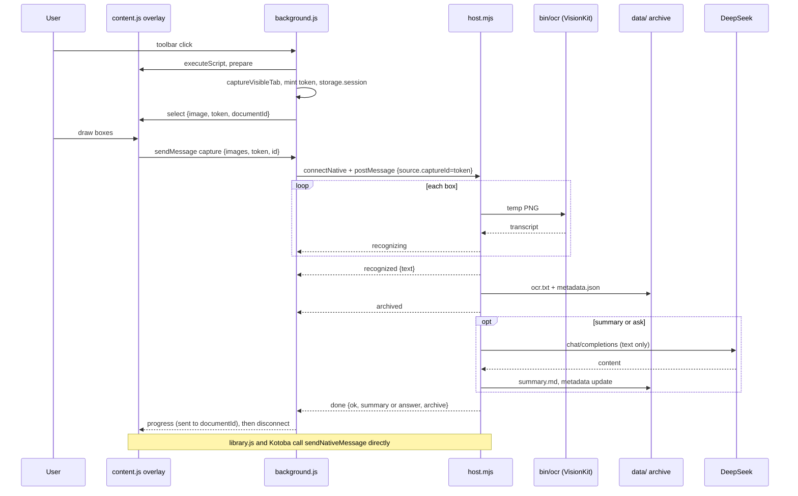

# How Magazine Reader works

Magazine Reader has two halves. A Chrome MV3 extension in `chrome/` takes a
screenshot of the Rakuten Magazine reader (`https://magazine.rakuten.co.jp/read/...`)
and lets you mark the article text. A Node native-messaging host in `host/` reads
that text with macOS Live Text, saves it to `data/`, and sends the text, never the
image, to DeepSeek for a summary or an answer.

The split is not a style choice. An extension cannot run OCR or write files, and
the host keeps the DeepSeek key out of the browser.

## The pieces you need to know

- **Capture.** The metadata of one screenshot:
  `{token, documentId, url, capturedAt, expires}`. `background.js` stores it in
  `chrome.storage.session` under `capture-<tabId>`. `token` is a fresh
  `crypto.randomUUID()` for every screenshot, and every overlay request must send
  it back.
- **Job.** One host request of type `capture`, `summarize`, or `ask`. Each job
  gets its own `connectNative` port. The `jobs` map in `background.js` allows one
  job per tab.
- **Progress event.** A frame the host writes while it works, such as
  `{id, stage: "recognized", text}` or `{id, done: true, ok, summary}`.
  `background.js` relays each one to the overlay as `{type: "progress", token, ...}`.
- **Part.** One box or page of a longer article. Parts are plain text joined by
  `――― Part N ―――` lines. `joinParts` in `host/deepseek.mjs` writes those lines,
  and the `PART` regex in `content.js` must match them.
- **Style or command.** A summary uses either a built-in style from `STYLES` in
  `host/deepseek.mjs` or a custom command, `{id, name, prompt, tokens}`, that you
  register in the overlay. The overlay keeps commands in `chrome.storage.local`
  under `readerCommands` and sends the whole command with each request.
  `cleanCommand` checks it in the host, and `commandPrompt` wraps your prompt in
  the same untrusted-text rules that the styles use.
- **Archive entry.** One folder per host request:
  `data/YYYY-MM-DD/HH-MM-SS.mmm-XXXXXX/`, with `ocr.txt`, `metadata.json`, and,
  after a DeepSeek reply, `summary.md`.

## What happens when you capture an article

1. You click the toolbar button. `captureReader` in `chrome/background.js`
   injects `summary.js` and `content.js`, because the extension has no static
   content scripts. It tells the overlay to hide and wait two animation frames,
   so the overlay stays out of the screenshot. It calls `captureVisibleTab`
   between two `assertActive` checks, so a tab switch fails the capture. It then
   mints the capture and sends the image to the overlay. The image is never
   stored.
2. You draw up to 12 boxes. `process()` in `content.js` crops each box to a PNG
   data URL, and `submit()` sends them with the token. The reply to that message
   only acknowledges it. Results arrive later as progress events.
3. `request()` in `background.js` checks the sender, the token, and the
   `documentId`, then bounds the payload: 1 to 12 images, 28 MB in total, and
   text up to 60,000 characters. It checks only the shape of a style or command
   and leaves the exact check to the host. It opens a port with `connectNative` and posts
   the job. `source` comes from the stored capture, never from the overlay. The
   job times out after 130 seconds plus 15 seconds for each extra box.
4. Chrome starts the launcher that `host/install.mjs` wrote. `main()` in
   `host/host.mjs` exits unless the caller's origin matches the extension ID
   derived from the `key` in `chrome/manifest.json`. `handle()` routes the
   request. For each box, `recognize()` in `host/ocr.mjs` checks the PNG, writes
   a private temp file, runs `bin/ocr`, and deletes the file.
5. `createArchive()` in `host/archive.mjs` writes `ocr.txt` and `metadata.json`
   before any network call. If the write fails, the request fails and DeepSeek is
   never called. An OCR-only capture ends here.
6. `complete()` in `host/deepseek.mjs` sends the text to `deepseek-flash`. Every
   prompt marks the article as untrusted text, not instructions. The host writes
   the reply to `summary.md`. For a custom command, `metadata.json` records
   `command: {id, name}` and leaves `style` null.
7. The overlay drops any event whose token or job ID does not match its own. It
   renders summaries with `magazineSummary.parse` from `chrome/summary.js`, which
   builds DOM nodes and never uses `innerHTML`.

A style tab switch, a custom command, **Regenerate**, or a question sends the current text again
with the same token. Each one is a new job and a new archive folder.

## How a multi-page article is built

**+ Add part** shows the standby bar so you can turn the page. **Capture page**
calls `restartCapture()`, which sends `{type: "reset"}`. `background.js` runs
`captureReader` again: a new screenshot and a new token. Because the overlay is
in append mode, it keeps the article. The new boxes go to the host as OCR-only
with `firstPart` set to the next part number. The overlay appends the returned
text to its own copy and adds a `Part 1` line to the first part if it has none.

The archive and the Library never stitch parts. Only the overlay's text does.

## How the Library reads the archive

`chrome/library.js` calls `chrome.runtime.sendNativeMessage` with
`{type: "library", action: "list"}` or `{type: "library", action: "read", ids}`.
It does not go through `background.js`. Each call starts its own host process.

`listCaptures` in `host/library.mjs` reads every folder under `data/`, groups
entries by `source.captureId`, and titles each group from its newest summary.
Each entry carries its `style` or its `command`, and the Library shows one tab
for each style and each command name.
Search is a case-insensitive substring match over every `ocr.txt` and
`summary.md`. `readCapture` accepts only IDs that match the `ENTRY_ID` regex,
sends each distinct text once, and keeps the reply under the 900 KB limit in
`host/protocol.mjs`.

Kotoba vocabulary requests also use `sendNativeMessage`, so a lookup never waits
behind a running summary. `host/kotoba.mjs` loads its modules from the separate
repository named by `KOTOBA_REPO`.

## Behavior that surprises people

- **A multi-page article becomes one Library group per page.** Every
  **Capture page** mints a new token (`chrome/background.js`, `captureReader`),
  and the Library groups by that token. An article captured over four pages
  shows as four groups. Only the last group holds the full text and the
  summaries.
- **Only new screenshots expire.** The 15-minute `expires` applies to
  `type: "capture"`. Summarize and Ask work for as long as the page stays open.
- **A service-worker restart loses the running job.** The capture survives in
  `chrome.storage.session`, but the `jobs` map lives in memory.
- **The host's `busy` flag guards one process, not one tab.** Every port is a new
  host process. The one-job-per-tab rule is the `jobs` map in `background.js`.
- **A failed request still leaves a folder.** The text is saved before DeepSeek
  runs, so the folder has `ocr.txt` and no `summary.md`.
- **`STYLES` exists in three files.** `host/deepseek.mjs`, `chrome/content.js`,
  and `chrome/library.js` each have a copy. Only comments keep them in step. The
  part marker is shared the same way.
- **The Library has no index.** Every list call and every search keystroke reads
  all of `data/`. Folder names use UTC. The Library's day headings use local
  time.
- **The launcher has the Node path written into it.** After you upgrade Node or
  move the repository, run `node host/install.mjs` again.

## Where the code lives

| Path | What it does |
|---|---|
| `chrome/manifest.json` | MV3 manifest. Its `key` pins the extension ID that the host trusts. |
| `chrome/background.js` | Captures, request checks, one native port per job, Kotoba relay. |
| `chrome/content.js` | The overlay: box selection, reader panel, parts, custom commands, Ask, Kotoba cards. |
| `chrome/summary.js` | Parser for model output, shared by the overlay and the Library. |
| `chrome/library.{html,js,css}` | The Library page, also the extension's options page. |
| `host/host.mjs` | `main()` reads framed messages. `handle()` routes them. |
| `host/protocol.mjs` | Native-messaging framing and size limits. |
| `host/ocr.mjs`, `ocr/ocr.swift` | OCR through VisionKit, built to `bin/ocr`. |
| `host/deepseek.mjs` | Styles, custom-command prompts, `joinParts`, `cleanText`, DeepSeek calls. |
| `host/archive.mjs` | Writes `data/`. |
| `host/library.mjs` | Reads `data/` for the Library. |
| `host/kotoba.mjs` | Bridge to the Kotoba repository. |
| `host/install.mjs` | Builds `bin/ocr`, writes the launcher and host manifest, stores the key. |
